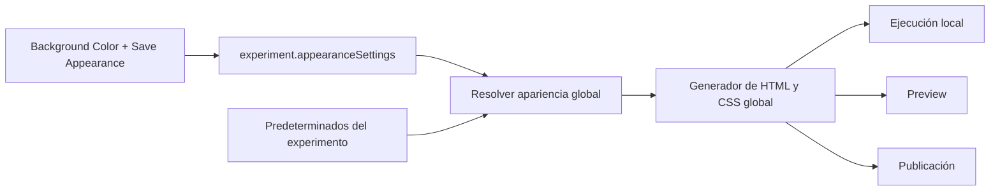

# SDD: fondo global del experimento

Estado: implementado y verificado.
Fecha: 2026-10-15.

## 1. Decisión

`Background Color`, en Experiment Appearance, configura un único fondo global
del experimento. Ese valor pertenece a `experiment.appearanceSettings`.
El HTML del experimento lo aplica mediante CSS. Dynamic Plugin dibuja sus
componentes sobre superficies transparentes y no administra el fondo global.

Ejecución local, preview de trial, preview de loop, preview completo y publicación
resuelven el color con la misma regla: configuración guardada del experimento;
si falta, blanco (`#ffffff`). Mostrar el valor predeterminado en la interfaz
debe producir el mismo resultado que guardarlo explícitamente.

Este SDD cubre el fondo de la superficie del experimento. Los fondos propios de
botones, textos, imágenes, encuestas y Sketchpad conservan su función y sus
parámetros. El fondo que muestra el diseñador sigue representando la apariencia
global; esa representación no se guarda dentro de los trials.

## 2. Problema comprobado

| Lugar | Comportamiento actual |
|---|---|
| `AppearanceSettings.tsx` y `appearance.js` | Guardan el ajuste global en el experimento; la interfaz muestra blanco cuando falta. |
| `TrialDesigner/useConfigFromComponents.ts` | Copia toda la apariencia global en `columnMapping.__canvasStyles` de cada trial guardado. |
| Generadores del Dynamic | Exportan esa copia como parámetro del plugin, incluso dentro de CSV y loops. |
| `server/dynamicplugin/index.ts` | Colorea el contenedor principal y la superficie visual persistente usando la copia del trial. |
| Plantillas HTML | Definen un gris independiente: `#f0f0f0`. |
| `Timeline/Actions.ts` | Construye la ejecución local sin pasar `appearance`. |
| `ExperimentPreview.tsx` | Envía `canvasStyles` al servidor y además colorea el iframe desde el cliente. |
| `experiments/html.js` | Combina lo recibido en `canvasStyles` con lo guardado; sin ambos, no resuelve un color predeterminado. |
| `experiments/publish.js` | Llama a `applyGeneratedArtifact` sin apariencia; este elimina el estilo global anterior antes de comprobar si recibió otro. |

En el HTML generado de `test`, los trials contienen blanco y el `body` conserva
el gris de la plantilla. No existe una apariencia guardada para ese experimento.
Se reprodujo en Chrome usando los estilos de ese HTML y la apariencia real del
trial: píxel blanco `[255,255,255]` durante el trial, gris `[240,240,240]` durante
la pausa y blanco al aparecer el destino.

El branching pausa para confirmar el guardado después de terminar el trial.
El contenedor temporal conserva los canvas y deja ver el fondo de la página.
La pausa hace visible la discrepancia. No se necesita configurar manualmente
dos colores para provocarla: los distintos valores predeterminados ya existen.

## 3. Fuente del valor y aplicación

El flujo será:

Una función del servidor, `resolveExperimentAppearance(experiment)`, resolverá
los campos guardados y los predeterminados. La compartirán GET de apariencia,
construcción local, construcción de preview y publicación. El predeterminado de
`backgroundColor` será `#ffffff`; se conservan `fullScreen: true` y
`progressBar: false` con sus funciones actuales.

El valor resuelto se aplica por un único generador de estilo global, antes de
ejecutar jsPsych. `body` tiene el fondo; los contenedores interiores del runtime
lo dejan visible mediante transparencia. Esto incluye el caso en que jsPsych
utiliza el propio `body` como `.jspsych-display-element`: ninguna regla posterior
debe volver transparente ese mismo elemento y anular el fondo global.

La aplicación del estilo es idempotente: regenerarlo sustituye la regla anterior
y deja un solo estilo global de apariencia. Las plantillas conservan estructura,
márgenes y recursos, pero no contienen otro color de fondo del experimento.

## 4. Contrato de construcción

Las peticiones de construir ejecución, preview y publicación identificarán el
experimento y enviarán el código generado y los datos que ya necesite cada
operación. No transportarán una segunda apariencia en `canvasStyles`.

Se elimina `appearance` de las opciones de `buildExperimentArtifact` y se elimina
`canvasStyles` de esos payloads y de sus lectores. Los endpoints correspondientes
rechazarán el campo retirado con HTTP 400 antes de escribir artefactos. No habrá
prioridad entre apariencia del request, del trial y del experimento: solo se
resuelve la del experimento guardado y sus predeterminados.

Esto cierra la inconsistencia de `Actions.ts` sin añadir una dependencia de que
cada botón recuerde enviar el color. El preview y la publicación tendrán el
mismo resultado que la ejecución local, incluido un experimento recién creado
que nunca haya usado Save Appearance.

El contexto del cliente continúa mostrando la apariencia global obtenida del
servidor. Sus valores iniciales para la interfaz deben coincidir con el contrato
del servidor; no se utilizan para crear un fondo alternativo en el artefacto.
Full Screen y Progress Bar mantienen sus generadores y su comportamiento.

## 5. Retirada del fondo del Dynamic

Se elimina el parámetro interno `__canvasStyles` del contrato y metadatos del
Dynamic Plugin. Se retira su producción en el diseñador, su traslado en los
generadores, la creación de columnas CSV asociadas y sus lecturas en runtime.
No se consultan copias antiguas del trial para elegir o recuperar un fondo.

El contenedor principal, la superficie persistente y el contenedor temporal de
transición no reciben un color global desde el plugin. Tampoco se introduce una
lectura de `document.body` para volver a pintarlo desde el Dynamic.

Las capas canvas/WebGL del trial deben componer con transparencia. Se verificará
el fallback blanco actual de `CanvasStage`: las capas del runtime tendrán fondo
transparente por defecto y limpiarán con alfa cero. Los dibujos y rellenos
explícitos de componentes se conservan; cambiar el fondo global no cambia el
color de un botón ni el papel del Sketchpad.

Se mantienen liberación de recursos, superficies persistentes, contenedores de
transición, geometría, z-index y mediciones de estímulos. No se cambia la barrera
de persistencia para ocultar el defecto ni se conserva un fondo por trial durante
el guardado. La página ya mantiene el color global durante todo el intervalo.

## 6. Preview, publicación y artefactos

- El preview completo, el seleccionado y el del diseñador consumen el HTML con
  el mismo fondo global resuelto. Se retira el fondo propio del elemento iframe
  y su override de apariencia; los controles de viewport y escala se conservan.
- El fondo del editor representa el ajuste global actual, sin producir una copia
  en `columnMapping`. El marco y los controles externos conservan sus colores de
  interfaz, fuera de la superficie del experimento.
- La publicación aplica el estilo global resuelto después de leer la plantilla
  o el HTML base. El resultado no depende de haber ejecutado localmente antes ni
  conserva un color antiguo del archivo reutilizado.
- Loading y CAPTCHA pueden seguir cubriendo la página con su interfaz. Cuando
  necesiten un fondo que coincida con el experimento, lo derivan del fondo global
  ya aplicado, sin introducir otro valor predeterminado para la página.
- Se actualizan el build local del Dynamic y la versión/referencia pública que
  corresponda a la entrega. La prueba de public usará el mismo build; publicar
  efectivamente el paquete o un experimento es una operación de entrega aparte.

Los cambios de Background Color se ven al regenerar ejecución, preview o
publicación. No requieren volver a guardar cada trial. Este trabajo no reescribe
ZIPs, `server/database/db.json`, HTML ya publicado ni código personalizado del
usuario. Los nuevos artefactos dejan de utilizar los campos internos retirados;
no se añade una migración ni un modo de ejecución para el fondo anterior.

## 7. Plan mediante TDD

1. Añadir regresiones que fallen con el estado actual: experimento sin apariencia
   guardada, publicación que pierde el estilo y Dynamic que aplica un fondo propio.
2. Probar el resolver global, aplicarlo en GET/run/preview/publish y retirar la
   apariencia paralela de requests y plantillas.
3. Probar y retirar `__canvasStyles` del diseñador, generación, metadatos y plugin;
   verificar la transparencia real de DOM, canvas y WebGL.
4. Ajustar preview y consumidores del cliente. Probar que cambiar el color global
   afecta artefactos nuevos aunque los trials conserven datos internos antiguos.
5. Ejecutar una regresión de navegador con branching real, guardado demorado y
   muestreo de píxeles antes, durante y después de la transición.
6. Verificar suites afectadas de cliente/servidor, compilación y runtime local y
   public, con datos aislados. Actualizar documentación del contrato y referencias.

No se considera suficiente comparar strings del CSS. La aceptación incluye el
color efectivamente compuesto durante la pausa y el siguiente frame, con el SDK
real de jsPsych y el Dynamic compilado. No se ejecutarán publicaciones reales
para probar el flujo: se inspeccionará el HTML capturado por el proveedor simulado.

## 8. Matriz de aceptación

| Caso | Resultado obligatorio |
|---|---|
| Apariencia inexistente, incompleta o predeterminada | Página blanca en local, preview y public, sin pulsar Save Appearance. |
| Color guardado distinto de blanco | Mismo color efectivo en los tres modos, con un único estilo global. |
| Color cambiado después de diseñar trials | El artefacto nuevo usa el color nuevo en todos los trials sin guardarlos otra vez. |
| Trial con una copia interna antigua distinta | Esa copia no se exporta ni determina el color del runtime. |
| Trial, loop y CSV generados | No se generan parámetros ni columnas `__canvasStyles`. |
| Transición adyacente, retorno y destino compartido | Mismo fondo antes, durante y después, sin gris ni blanco alternativo. |
| Entrada/salida de loops anidados y cambio de fila | Fondo estable; mismos IDs, filas, repeticiones y respuestas que antes. |
| Guardado de resultados demorado | Color global estable durante toda la pausa; se conserva la espera de persistencia. |
| DOM, WebGL, superficie persistente y contenedor de transición | Superficies transparentes; color global visible donde no hay contenido dibujado. |
| Botones, textos, encuestas y Sketchpad con colores propios | Se conservan los colores configurados para esos componentes. |
| Preview de trial, loop, completo y diseñador | Mismo fondo global; viewport, escala y frame de interfaz siguen funcionando. |
| Publicar sin HTML local previo o usando uno con otro color | Se aplica la apariencia global actual, sin depender del archivo anterior. |
| Reconstruir dos veces | Un solo estilo global; no quedan reglas acumuladas ni gris en plantillas nuevas. |
| Request con `canvasStyles` retirado | HTTP 400 antes de escribir el artefacto; sin fallback ni lectura del campo. |
| Full Screen, Progress Bar, CAPTCHA y loading | Conservan sus funciones y derivan de la apariencia global cuando corresponde. |

Las pruebas usarán bases y experimentos temporales. Si una herramienta devuelve
`Transport closed` o aparece un error de falta de espacio, se detendrá el trabajo
según la instrucción vigente del usuario.

## 9. Archivos de referencia

- [Ajuste global en la interfaz](../client/src/pages/ExperimentPanel/AppearanceSettings.tsx).
- [Lectura y guardado de apariencia](../server/routes/experiments/appearance.js).
- [Generación del estilo global](../server/routes/experiments/artifact.js).
- [Construcción local y preview](../server/routes/experiments/html.js).
- [Publicación](../server/routes/experiments/publish.js).
- [Acción de ejecución](../client/src/pages/ExperimentBuilder/components/Timeline/Actions.ts).
- [Servicio de construcción](../client/src/pages/ExperimentBuilder/modules/experiment-runtime/experimentArtifact.ts).
- [Preview](../client/src/pages/ExperimentBuilder/components/ExperimentPreview.tsx).
- [Copia actual dentro del trial](../client/src/pages/ExperimentBuilder/components/ConfigurationPanel/TrialsConfiguration/TrialDesigner/useConfigFromComponents.ts).
- [Aplicación actual dentro del Dynamic](../server/dynamicplugin/index.ts).
- [Capas canvas/WebGL](../server/dynamicplugin/renderer/CanvasStage.ts).

## 10. Implementación y evidencia

El servidor utiliza `appearanceSettings.js` para resolver la apariencia guardada
y sus predeterminados en GET, run, preview y publish. El HTML recibe un único
`style#experiment-appearance`; las plantillas no definen otro color. El request
retirado se rechaza antes de escribir artefactos o actualizar registros.

Se retiraron el parámetro del Dynamic, sus escrituras de fondo, los argumentos
de la superficie persistente y las exportaciones del diseñador/generador. Las
capas WebGL limpian con transparencia por defecto. El diseñador descarta el campo
retirado al volver a guardar; el generador tampoco lo exporta si sigue presente
en datos antiguos o metadatos almacenados. No se modificó la base real del usuario.

TDD reprodujo primero el fallo del servidor y la copia dentro de los trials.
La regresión de navegador falló porque la copia antigua pintaba rojo encima del
color global; después pasó con la superficie transparente y el mismo guardado
detenido durante varios frames.

| Verificación | Evidencia |
|---|---|
| Cliente | 1,676 pruebas aprobadas: 1,661 en el recorrido general y 15 de cinco suites de navegador reejecutadas con Chrome instalado. |
| Servidor afectado | 75 pruebas aprobadas: apariencia, ejecución, preview, publicación simulada, plantillas e importación. |
| Fondo en navegador | 7 casos aprobados con píxeles reales en local, preview y HTML público, incluido el traspaso persistente de imágenes. |
| Regresiones de runtime | 23 casos aprobados: preview de 480 filas, continuidad de loops, salidas anidadas, persistencia pública y viewport adaptable. |
| Tipos y build | `tsc -b` y build del Dynamic aprobados. |
| Contratos de pruebas | Verificadores de cobertura de runtime y máximo de líneas aprobados. |

Las pruebas públicas inspeccionaron la publicación mediante proveedor simulado y
ejecutaron el mismo build local en navegador. El Dynamic está preparado como
versión `1.0.8`; su publicación efectiva en npm/CDN queda como paso de entrega.
