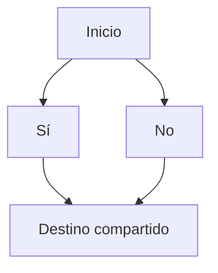

# SDD: contrato único de Branching y erradicación de Jump

Estado: contrato implementado y verificado.
Fecha: 2026-10-15.
Base: `36f4711`, `refactor(runtime): unify branching and jumps with native jsPsych timelines`, y sus correcciones posteriores.

## 1. Decisión y alcance

Toda conexión de navegación tendrá un único significado: ir al trial elegido y continuar desde sus conexiones. Avanzar, volver a un trial anterior y entrar o salir de loops utilizan el mismo contrato de Branching.

Jump desaparece como concepto del producto y del contrato completo, como operación, clasificación y comportamiento separado en todo el proyecto. El alcance comprende el código propio del cliente, servidor, API y servicios de publicación/ejecución donde intervengan en navegación: interfaz, tipos, validadores, payloads, importación/exportación, funciones, generadores, runtime, persistencia, almacenamiento, eventos, errores, pruebas, escenarios, scripts, nombres de archivos y documentación mantenida. No basta con ocultar la palabra en el selector, cambiar el nombre de `requestJump` o retirar únicamente las referencias de `client/`.

No habrá compatibilidad de navegación con el contrato anterior: sin conversores, lectores dobles, aliases, migraciones, detección de formatos antiguos ni ejecución alternativa con recarga. Los datos que no satisfagan el nuevo contrato serán inválidos. La implementación de este SDD no autoriza borrar ni convertir los experimentos del usuario.

Actualización temporal autorizada el 2026-10-15: se permite convertir backups
anteriores únicamente al importarlos, según
[la migración temporal de importación](legacy-experiment-import.md). Esta
excepción se retira después de la versión de transición; edición, compilación
y ejecución siguen aceptando únicamente el contrato actual.

Se reutilizan el coordinador, los timelines nativos de jsPsych, las direcciones por ID, la persistencia y el seguimiento de loops existentes. El cambio no incluye paginación, componentes del Dynamic Plugin ni otro motor de ejecución.

Erradicar el concepto no elimina la capacidad de volver a un trial, entrar o salir de un loop, guardar datos o recuperar una sesión. Esas capacidades pasan a depender exclusivamente del contrato único de Branching y de resume, sin una segunda operación equivalente bajo otro nombre.

## 2. Problema confirmado antes de la implementación

La clasificación del editor acepta un destino existente en `branches` o uno situado después del origen en el array. El guardado puede añadir ese destino a `branches`. Por eso una condición puede crear una conexión nueva por su posición, mientras una conexión equivalente hacia un destino anterior se convierte en Jump.

El refactor citado unificó el mecanismo que llega al destino, pero mantuvo dos políticas:

- `routeEntries` agrega una continuación por posición para `jump` y `resume`.
- `completeTrial` cierra o recupera la continuación de una entrada `branch`, con una regla especial para uniones de ramas.

También permanecen separados el guardado de condiciones, los parámetros de destino y la espera de persistencia. La implementación comenzó con una regresión de navegador del destino compartido; falló al ejecutar un trial ajeno después del destino elegido. Esa reproducción se conserva como prueba.

## 3. Comportamiento esperado



Con esas conexiones, elegir Sí ejecuta `Inicio → Sí → Destino compartido`; elegir No ejecuta `Inicio → No → Destino compartido`. Se obtiene el mismo resultado aunque los registros de No y Destino compartido se hayan creado o almacenado en otro orden.

| Configuración | Resultado obligatorio |
|---|---|
| B tiene una conexión seleccionada hacia C | Ejecutar C y seguir las conexiones de C. |
| B no selecciona ninguna salida y su salida por defecto es nula | Cerrar el recorrido actual. |
| C únicamente aparece después de B en el almacenamiento | Esa posición no autoriza ejecutar C. |
| Dos caminos llegan a B | Usar las salidas de B; recibir dos conexiones no crea una continuación adicional. |
| B selecciona un trial ya ejecutado | Crear una nueva ejecución de ese trial, con la misma regla de continuación. |
| El destino pertenece a otro loop | Resolver su dirección y la jerarquía de loops; la posición no determina otro tipo de navegación. |

Cerrar un recorrido no siempre termina el experimento: dentro de un loop puede terminar la fila actual y permitir sus siguientes filas o repeticiones. En el timeline principal, sin una continuación declarada, termina la ejecución. El cierre completo del experimento debe seguir siendo una decisión explícita.

## 4. Contrato de autoría

Se mantienen los nombres `branches` y `branchConditions` y se añade una salida por defecto explícita:

```typescript
type ItemId = string | number;
type BranchTarget = ItemId | "FINISH_EXPERIMENT";

type TrialBranching = {
  branches: ItemId[];
  branchConditions: Array<{
    id: number;
    rules: BranchRule[];
    nextTrialId: BranchTarget;
    customParameters?: Record<string, ColumnMappingEntry>;
  }>;
  defaultNextTrialId: BranchTarget | null;
};
```

`branches` declara las conexiones salientes visibles del trial; no determina su tipo ni una salida por posición. Cada destino de condición y de salida por defecto debe corresponder a una de esas conexiones, salvo la señal explícita de terminar el experimento.

Las condiciones se evalúan en el orden de prioridad configurado. La primera coincidencia elige el destino y sus parámetros. Si ninguna coincide, se usa `defaultNextTrialId`. Un valor nulo cierra el recorrido. No se deduce una salida mediante `branches[0]`, la fecha de creación, el siguiente registro o el número de conexiones entrantes.

Todas las condiciones permiten los mismos parámetros de destino. Los cambios de parámetros se aplican una sola vez a la nueva ejecución del trial y no modifican su definición compartida.

Los orígenes y destinos de Branching siguen siendo trials; los loops conservan su papel de contenedores. Para entrar a un loop se elige un trial dentro de él. Los IDs se comparan por identidad normalizada, sin interpretar su antigüedad ni su valor numérico como orden de ejecución.

Cada ámbito conserva una entrada explícita `entryItemId`, tanto el principal como cada loop. Puede apuntar a un trial o a un loop hijo. Su creación y edición son intencionales; no se recalcula según qué nodos carezcan de conexiones entrantes. Esto permite volver al inicio sin que desaparezca la entrada al convertirse el recorrido en un ciclo.

Cada loop declara además `nextItemId: ItemId | null`, una continuación estructural en el ámbito de su padre. Se utiliza cuando el procedimiento termina sin una salida ordinaria diferida de su última fila. Agrupar actualiza esas continuaciones: el padre conserva el sucesor exterior y el hijo no guarda una continuación hacia un hermano de su padre. La importación, la edición y el grafo validan este campo.

Las operaciones de añadir o reordenar una secuencia deben actualizar sus conexiones normales y la entrada cuando corresponda. Los arrays de registros no son una segunda fuente de navegación. La secuencia estructural de un padre conserva su significado para completar sus loops; cambiar ese orden explícitamente sigue siendo una edición del experimento.

## 5. Aclaración de `repeatConditions` y repeticiones

La eliminación se refiere al uso del campo como navegación hacia otro destino. No se eliminarán funciones de repetición por una coincidencia de nombre.

La revisión previa encontró lo siguiente:

| Elemento | Función actual | Decisión |
|---|---|---|
| `Trial.repeatConditions` / `RepeatCondition.jumpToTrialId` | Navegación hacia otro trial. | Sustituir funcionalmente por el contrato único; retirar esos campos y ese tipo de navegación. |
| `Loop.repeatConditions` / `generateLoopRepeatLifecycle` | Navegación desde `on_timeline_finish` usando `jumpToTrialId`. | Retirar ese camino especial de navegación; no confundirlo con la repetición del loop. |
| `Loop.repetitions` | Número de repeticiones del procedimiento. | Conservar. |
| `Loop.loopConditions`, `isConditionalLoop` y `loop_function` | Decidir si vuelve a ejecutarse un ciclo del loop. | Conservar. |
| CSV, sampling, aleatorización, órdenes y categorías | Selección y recorrido de filas. | Conservar. |
| Callbacks personalizados del loop | Código configurado por el usuario. | Conservar los callbacks; no convertir su código antiguo automáticamente. |

En los usos revisados, `RepeatCondition` contiene `jumpToTrialId`: no es el contrato de repetición normal o condicional del loop. Si la implementación descubre un consumidor distinto, deberá documentarlo y conservar su función antes de retirar el símbolo. Los nombres de variables del código personalizado del usuario están fuera de esta limpieza.

Los loops no recibirán una nueva variante de Branching para sustituir el antiguo callback especial. Una salida ordinaria después de un loop pertenece a su secuencia estructural; las decisiones condicionales de navegación se configuran en trials. Los datos anteriores de navegación al terminar un loop no se convertirán.

## 6. Grafo, validación y entrada

El servidor validará el estado resultante completo antes de modificar la base de datos. Crear, editar, importar y compilar utilizarán el nuevo contrato. Un PATCH se valida contra el documento combinado, no solamente contra los campos enviados.

- Deben existir todos los destinos, propietarios y entradas; se rechazan referencias a otro experimento y destinos loop en una condición de trial.
- Las condiciones y la salida por defecto deben coincidir con las conexiones visibles. Seleccionar un destino nuevo guarda condición y conexión de forma atómica y explícita.
- Se permiten conexiones de retorno, incluida una nueva ejecución del mismo trial. Un ciclo de navegación no es un ciclo de propiedad de loops.
- Se siguen rechazando loops que se contienen a sí mismos, propiedad ambigua y entradas que no pertenecen al ámbito declarado.
- Un destino eliminado debe dejar una configuración consistente mediante la operación de borrado; la compilación no debe repararlo silenciosamente ni inventar una ruta.
- Los formatos anteriores de navegación fallan con un error de contrato comprensible, antes de escribir datos, preparar archivos o iniciar la ejecución. Un contrato ausente no activa un modo anterior.

`BRANCH_CYCLE` dejará de rechazar automáticamente las vueltas configuradas. El cierre de un ciclo depende de las condiciones del experimento; el motor no impone un límite arbitrario de visitas. La validación de la jerarquía de loops permanece separada.

## 7. Plan de ejecución y canvas

El manifiesto existente evolucionará para expresar la entrada y los sucesores de cada ámbito por ID. El compilador materializará las conexiones normales, las condiciones y la continuación estructural al completar un loop. Canvas y runtime consumirán esa misma información de recorrido.

No se obtendrá la continuación de un trial mediante `allScopes.slice(index + 1)` ni se recuperará por ser un destino compartido. Si una unión B debe continuar a C, tendrá una conexión normal explícita hacia C. La creación o edición de esa secuencia debe persistirla.

Las conexiones de retorno se dibujarán como conexiones del mismo contrato. El layout debe terminar ante ciclos y mostrar un solo nodo por entidad, aunque el runtime la ejecute muchas veces. El número de padres y las coordenadas del dibujo no alteran las decisiones del participante.

La continuidad al completar un contenedor es parte del plan del padre. No se utilizará esa continuidad para agregar trials ajenos al recorrido seleccionado dentro del contenedor.

## 8. Una operación sobre los timelines nativos

Se conserva `requestBranch` como operación de navegación y el mecanismo de `performTransition`. Se retiran `requestJump`, `pendingJump` y el comportamiento alternativo por `kind: 'jump'`. Tampoco se conserva un segundo modo equivalente bajo otro nombre.

La retirada no consiste en borrar indiscriminadamente los archivos actuales cuyo nombre contiene Jump. Antes de eliminarlos, se reasignan las responsabilidades todavía necesarias:

| Responsabilidad compartida actual | Ubicación funcional tras la unificación |
|---|---|
| Resolver y validar destino, propietario, cadena de loops y revisión del experimento. | Manifiesto y validación del contrato único de Branching; también los consume resume. |
| Esperar el resultado del origen y las escrituras pendientes. | Única transición de Branching integrada con la persistencia existente. |
| Guardar y restaurar destino pendiente, parámetros, colas y progreso de recuperación. | Checkpoint vigente y resume, sin solicitudes ni protocolos de Jump. |
| Detectar estados inválidos y mantener limpieza de frames y parámetros. | Coordinador y estado común de ejecución. |
| Declarar productores y consumidores del estado generado. | Contrato de composición actualizado, sin exigir un estado separado para Jump. |

La implementación debe seguir sus consumidores antes de retirar tipos, serializadores o helpers; algunos se usan actualmente al recuperar una sesión. Se conserva la función necesaria dentro del contrato nuevo, no un alias, wrapper o modo oculto de la operación retirada. La compilación y las pruebas de persistencia y resume deben demostrar que la erradicación no deja dependencias rotas ni responsabilidades sin consumidor.

La decisión procede del resultado del trial que acaba de terminar, se calcula una sola vez y selecciona una conexión. El inicio de B no cambia sus condiciones: al terminar B, se calculan sus propias salidas con la misma regla.

La transición modifica únicamente entradas futuras. Volver a un trial inserta una nueva entrada futura con su definición; no retrocede el cursor interno de jsPsych. Esta restricción está documentada en [modificación de timelines en runtime](https://www.jspsych.org/latest/overview/timeline/#exception-cases-for-addingremoving-timeline-nodes-dynamically).

El coordinador conserva el ancestro activo común, cierra los loops que abandona y entra en los procedimientos que aportan las variables del destino. Puede usar [`abortTimelineByName`](https://www.jspsych.org/latest/reference/jspsych/#jspsychaborttimelinebyname) para cerrar el nivel necesario. Su estado se limpia antes del aborto, sin depender de callbacks de finalización del loop abortado.

La señal `FINISH_EXPERIMENT` cierra toda la ejecución. La ausencia de una salida cierra solamente el recorrido correspondiente. Los tipos de entidad trial/loop y la diferencia entre una condición coincidente y una salida ordinaria son datos válidos del plan; no representan dos operaciones de navegación.

## 9. Loops anidados y repetición

| Situación | Regla |
|---|---|
| Regreso a un trial del mismo loop activo | Conservar la fila y repetición actuales; crear otra ejecución del destino. |
| Destino en un ancestro activo | Abortar los loops interiores abandonados y conservar la fila del ancestro. |
| Destino en un loop hermano | Cerrar la rama de contenedores abandonada y abrir el destino con su jerarquía de variables. |
| Entrada a un loop no activo | Crear su ejecución normal; la primera fila empieza en el destino elegido y las siguientes en su entrada configurada. |
| Fin de recorrido dentro de un loop | Completar la fila; jsPsych decide sus siguientes filas, repeticiones y ciclos condicionales. |
| Salida ordinaria del último trial hacia fuera | Diferirla hasta que termine el procedimiento del loop. |
| Condición que selecciona una salida hacia fuera | Aplicarla al terminar el trial origen y abandonar los loops afectados. |

La diferencia entre salida ordinaria y condición coincidente conserva la intención ya existente de completar un loop o abandonarlo. Se aplica igual a todos los destinos, sin depender de si se crearon antes o después.

Cada fila reconstruye su recorrido inicial. Una decisión de una fila no cambia las siguientes ni las definiciones reutilizadas. Al volver a entrar a un loop que ya se cerró se crea otra ejecución, no se reutiliza accidentalmente un frame terminado.

Las repeticiones siguen apoyándose en [`repetitions` y `loop_function` de jsPsych](https://www.jspsych.org/latest/overview/timeline/#looping-timelines); el coordinador conserva su seguimiento para resume.

## 10. Persistencia, resume y preview

La política de guardado deja de depender del nombre del movimiento. Cada transición utiliza los callbacks de persistencia existentes, guarda el resultado del origen una sola vez y registra el destino y las colas elegidas en el checkpoint.

Cuando haya escrituras pendientes, se detiene el avance al siguiente trial hasta completar la barrera de persistencia. El `on_finish` debe poder terminar para que llegue el callback de datos; no esperará dentro de él una escritura que todavía depende de su propia finalización. Sin guardado, el reconocimiento se resuelve en memoria. Un fallo de persistencia no provoca una recarga para intentar navegar.

Resume restaura el trial pendiente, las colas, la fila, el orden muestreado, la repetición y los resultados del ciclo condicional. No reevalúa la condición del origen ni entra de nuevo en un loop abandonado. Los parámetros todavía pendientes se consumen exactamente una vez.

El manifiesto y el checkpoint pasarán a una nueva versión única; no habrá parser de versiones anteriores ni rutas de recuperación basadas en los antiguos protocolos. Una revisión o dirección inválida se comunica como error sin ejecutar una ruta alternativa.

Local, public y preview conectan el mismo coordinador. El preview de una selección no ejecuta destinos ausentes de esa selección. Cada nuevo artefacto exige el nuevo contrato; los HTML publicados previamente no se reescriben mediante esta tarea.

## 11. Interfaz y erradicación del concepto en el proyecto

La pantalla será Branching: condiciones, prioridad, destino, parámetros opcionales y salida por defecto. Ofrece los trials válidos sin separarlos por antigüedad, dirección o posición. La entrada del recorrido y sus conexiones normales también se muestran en el canvas.

Elegir `Inicio → Branch desde no` será una conexión intencional y visible del usuario bajo este contrato; no una clasificación que aparece porque el destino está después en un array. La autoría de una condición y la edición del canvas mantendrán las conexiones consistentes.

La limpieza incluye `JumpRequest`, `ExpBuilderJumpProtocol`, `jumpToTrialId`, `repeatConditions` de navegación, claves de almacenamiento, eventos, errores, referencias de composición, comentarios, exportaciones y nombres de archivos relacionados en todos sus productores y consumidores. El servidor y los servicios no conservarán campos, endpoints ni normalizadores que implementen la operación retirada. Se actualizan también los fixtures, escenarios y contratos de cobertura que la exigen, tanto en el cliente como fuera de él.

La comprobación final abarca el repositorio completo: `client/`, `server/`, `api/`, pruebas de raíz, scripts, configuración y documentación mantenida, además de cualquier otro módulo propio que produzca o consuma navegación. No debe existir una API, esquema, enum, clave, evento, error o camino de ejecución que siga tratando Jump como un concepto distinto. También se revisan imports, nombres de archivos y referencias de CI; no basta con comprobar la interfaz o realizar una sustitución textual.

Las referencias de este SDD al concepto retirado sirven únicamente para especificar su eliminación y las evidencias históricas; no habilitan excepciones funcionales. La documentación normativa vigente del producto describirá únicamente Branching. Se excluyen de la limpieza las dependencias de terceros, el historial de Git y los datos o código personalizados del usuario, que no se reescriben automáticamente. Los artefactos nuevos y las versiones publicadas que se regeneren utilizarán exclusivamente el nuevo contrato.

## 12. Cambios sobre los módulos existentes

| Área | Cambio previsto |
|---|---|
| `modules/experiment-authoring/intents/branching.ts` y modal `BranchedTrial` | Un único guardado y selector; retirar clasificación por posición y conversión entre dos tipos. |
| Tipos de configuración, providers y cliente de autoría | Contrato de salida por defecto y entradas explícitas; retirar campos de navegación anteriores. |
| `server/routes/timeline/branchContract.js`, grafo y mutaciones | Validación del nuevo estado, conexiones cíclicas válidas, entradas consistentes y rechazo de formatos no conformes. |
| Rutas del servidor, importación/exportación, API y servicios que produzcan o consuman navegación | Retirar campos y caminos de Jump del contrato completo; ninguna conversión ni compatibilidad con esa operación. |
| `branchEvaluator.ts` y generadores `on_finish` | Una evaluación, prioridad explícita, salida por defecto y parámetros comunes. |
| `executionAddressManifest.ts`, `nativeTimelineNavigation.ts` y coordinador | Sucesores por conexiones, una transición y eliminación de la continuación por posición. |
| Estado de ejecución, persistencia y `loopResumeRuntimeCode.ts` | Un checkpoint vigente y recuperación de las colas elegidas sin protocolo alternativo. |
| Generadores de loops y ciclo de vida de trials | Retirar únicamente la navegación anterior; conservar repeticiones, condiciones y callbacks propios. |
| Canvas, pruebas de cliente/servidor/raíz, scripts, CI y documentación mantenida | Mismo contrato; conexiones de retorno seguras para el layout y erradicación del concepto retirado en todo el código propio del proyecto. |

La implementación permanece en esos módulos. No se añade un paquete `shared/codegen` ni imports del cliente hacia archivos de `server/`. Los tipos del cliente y la validación del servidor se contrastan mediante pruebas de contrato.

## 13. Implementación mediante TDD

1. Añadir una prueba real de runtime del caso reportado y registrar su fallo antes de cambiar el comportamiento. Usar fixtures nuevos e independientes de `server/database/db.json`.
2. Probar y aplicar el contrato de autoría, las entradas y las decisiones por defecto. Las pruebas deben demostrar los fallos de posición, no limitarse a exigir cadenas de código generado.
3. Probar y corregir la continuación con el coordinador actual. Cada corrección se comprueba con secuencias de IDs ejecutados y resultados persistidos.
4. Incorporar entradas, salidas y vueltas en loops anidados, luego interrupción y resume en los mismos recorridos.
5. Integrar el selector y el canvas, retirar los caminos anteriores en todos sus productores y consumidores y actualizar los escenarios de local y public.
6. Verificar compilación, contratos del servidor/API, pruebas del cliente/servidor/raíz y runtime, cobertura de escenarios y erradicación del concepto retirado en todo el proyecto. Probar las responsabilidades compartidas antes y después de eliminar sus módulos actuales.

No se inicia la limpieza masiva de símbolos antes de que las pruebas de comportamiento determinen qué debe conservarse. La entrega se registra como implementación del contrato completo, no como un cambio visual del selector.

## 14. Matriz mínima de aceptación

| ID | Escenario y evidencia |
|---|---|
| B01 | Dos caminos hacia el mismo destino: ambas respuestas producen los IDs esperados; distintas permutaciones de almacenamiento no cambian el resultado. |
| B02 | Inicio → B, B sin salida y C independiente después: C no se ejecuta. |
| B03 | Inicio → B → C: C se ejecuta una sola vez por visita, incluso después de un retorno a B. |
| B04 | Condiciones múltiples y ninguna coincidente: prioridad y salida por defecto explícitas, nunca `branches[0]`. |
| B05 | B → Inicio y B → B con condiciones de salida finitas: nuevas visitas correctas, sin recarga ni otra sesión. |
| B06 | Una unión de caminos con y sin salida propia: las conexiones entrantes no cambian su continuación. |
| B07 | Mismo loop, loops hermanos y salidas al padre, abuelo y principal: IDs, abortos y valores CSV correctos. |
| B08 | Matriz de profundidades 1, 2, 3 y una mayor generada; más de una decisión por nivel y destinos a distintos ancestros. |
| B09 | Varias filas, órdenes, categorías, aleatorización, repeticiones y ciclos condicionales: recorrido completo y mismo orden tras resume. |
| B10 | Entrada en medio de un loop y regreso dentro de la fila: primera entrada, filas posteriores y retorno al padre según el contrato. |
| B11 | Salida ordinaria de un loop frente a salida condicional: completar sus filas o abandonarlas según la intención, sin perder datos del origen. |
| B12 | Recarga después de persistir el origen y antes del destino; recarga durante un trial: restaurar el punto correcto, sin duplicar resultados ni parámetros. |
| B13 | Persistencia con demora y con error, guardado deshabilitado y preview parcial: barrera correcta, ausencia de bloqueos y destinos fuera de selección omitidos. |
| B14 | Local y public: mismos IDs, decisiones y continuidad, con sus callbacks reales de persistencia y sin recarga para navegar. |
| B15 | Create/PATCH/import/compile inválidos: rechazo antes de modificar datos o producir artefactos; eliminación/movimiento de nodos conserva entradas y referencias válidas. |
| B16 | Canvas con ciclos, unión y múltiples entradas: termina el layout, muestra las conexiones configuradas y no decide rutas por sus coordenadas. |
| B17 | Auditoría de todo el proyecto: código propio, contratos, nombres de archivos, pruebas, scripts, CI y documentación vigente sin el concepto retirado, sin interfaces duplicadas ni formatos de navegación anteriores aceptados. |
| B18 | Tras retirar los módulos anteriores, resolución/validación de destinos, barrera de persistencia, parámetros y resume siguen pasando sus pruebas; no quedan imports rotos, estados sin consumidor ni una operación alternativa con otro nombre. |

La aceptación compara recorridos completos y filas guardadas; que el servidor acepte una conexión o que el selector la etiquete correctamente no demuestra que runtime funcione. Los resultados de cada suite se reportarán con su alcance real. Si una herramienta devuelve `Transport closed` o falla por falta de espacio, se detiene el trabajo según la instrucción del usuario.

## 15. Referencias de implementación revisadas

- [Navegación nativa actual](runtime-timeline-navigation.md).
- [Clasificación y guardado del editor](../client/src/pages/ExperimentBuilder/modules/experiment-authoring/intents/branching.ts).
- [Transiciones y continuación actuales](../client/src/pages/ExperimentBuilder/modules/experiment-runtime/nativeTimelineNavigation.ts).
- [Coordinador y persistencia](../client/src/pages/ExperimentBuilder/modules/experiment-runtime/navigationCoordinatorKernel.ts).
- [Evaluación de condiciones](../client/src/pages/ExperimentBuilder/modules/experiment-runtime/branchEvaluator.ts).
- [Tipos de trials, loops y condiciones](../client/src/pages/ExperimentBuilder/components/ConfigurationPanel/types/index.ts).
- [Generación de procedimientos de loops](../client/src/pages/ExperimentBuilder/components/ConfigurationPanel/TrialsConfiguration/LoopsConfiguration/useLoopCode/index.ts).
- [Repetición condicional del loop](../client/src/pages/ExperimentBuilder/components/ConfigurationPanel/TrialsConfiguration/LoopsConfiguration/useLoopCode/services/generateConditionalLoopFunction.ts).
- [Contrato actual del servidor](../server/routes/timeline/branchContract.js).

## 16. Implementación y evidencia

Se conservaron los módulos existentes del compilador y coordinador. La API ejecutada es `requestBranch(data, decision)` y el formato único de manifiesto/checkpoint es versión 3. Se retiraron la segunda operación, sus claves, serializadores, callbacks y el conversor de importación. Las importaciones se validan completas antes de restaurar documentos o medios; no se modificaron los experimentos del usuario.

La implementación conserva los timelines nativos para filas, muestreo, repeticiones y ciclos condicionales. Los callbacks de WebGazer producen una sola decisión por trial completo. Cada fila reinicia su salida diferida; un checkpoint de terminación explícita no vuelve a abrir un loop cerrado.

Evidencias principales:

- `client/runtime-e2e/scenarios/unified-branching-runtime.spec.ts`: reproducción del destino compartido creado antes, sin ejecución del trial ajeno.
- `client/src/pages/ExperimentBuilder/modules/experiment-runtime/branchEvaluator.test.ts`: prioridad, parámetros y salida por defecto independiente del orden de las aristas.
- `client/src/__tests__/components/codegenRuntime/unifiedBranching.test.ts`: retornos, repetición del mismo trial, barrera de persistencia, CSV, salidas entre 1, 2, 3 y 8 niveles, recuperación de parámetros y terminación.
- `__tests__/unified-branching-contract.test.js`: ciclos, entradas, inserción secuencial, pertenencia y continuaciones de contenedores.
- `server/__tests__/routes/db-navigation-import.test.js`: rechazo de formatos, destinos y propiedad inválidos antes de restaurar datos o medios.
- `client/src/__tests__/components/canvasExpandedLayout/navigationCycles.test.ts`: dibujo de retorno y conexión al mismo trial.
- Escenarios `native-public-navigation-runtime`, `loop-resume-runtime`, `nested-loop-exit-levels-runtime` y `nested-loop-image-routes-runtime`: recorridos, datos persistidos y recuperación con el SDK real.

Las etiquetas históricas `TJ-*` permanecen como identificadores de requisitos de cobertura; ya verifican las responsabilidades de navegación y recuperación del contrato único. No representan un modo adicional del runtime.

### Resultado de verificación

Las suites se ejecutaron por separado, cubriendo las etapas del runner general. La ejecución final completa de runtime aprobó sus 70 escenarios sin reintentos ni fallos.

| Verificación | Resultado |
|---|---|
| Cliente unitario | 1,660 aprobadas; 15 omitidas por la configuración existente. |
| Raíz y servidor | 602 aprobadas; las pruebas cloud condicionadas se ejecutaron por separado. |
| Functions | 528 aprobadas. |
| Editor en navegador | 140 aprobadas. |
| Runtime generado en navegador | 70 aprobadas en una ejecución completa. |
| Cloud con emuladores y proveedores simulados | 4 pruebas de proveedores y 1 recorrido público compuesto aprobados. |
| TypeScript | `tsc -b` aprobado; 62 pruebas de acciones del canvas aprobadas después del ajuste final de tipos. |
| Bundle jsPsych, límites de archivos y matriz de cobertura | Build y verificadores aprobados; se conservan los bloqueos documentados del plan histórico de cobertura. |

La auditoría del código y documentación mantenida no encontró APIs, nombres de archivos ni referencias operativas a la operación retirada. Los datos del usuario, sus backups, artefactos publicados anteriores y este registro de diseño quedan fuera de la limpieza textual.
